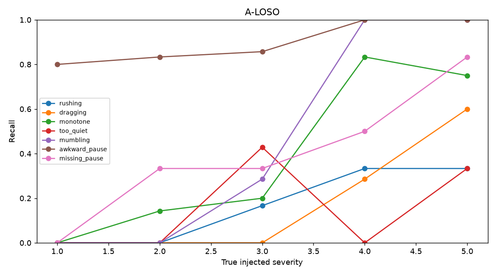

# 1. Problem and approach

Speech-Eval shows you delivery problems such as speaking too fast, too quietly,
or pausing in an awkward place. It marks the affected words and times so you can
listen to the exact part. It explains each flag using measured differences from
reference readers or your earlier take.

::: summary
Frozen A: precision 0.125, recall 0.400, F1 0.190.
Frozen B: precision 0.018, recall 0.390, F1 0.035.
A clean alarms: 1.341/min; dev guard failed (1.777 versus <=0.5/min).
Release: 1,103 indexed recordings, 36.3 h; repeated scientific hashes match.
Limits: low precision; genuine labels are recorder-confirmed, not independent; zero rater responses.
:::

Content quality is out of scope.
Controlled edits supply reproducible operation labels, not independent judgments
of good speaking. A uses same-text train readers; B uses the speaker's earlier
take; C-lite uses sentence norms without a same-text reference. Key-moment
messages are labelled heuristics, not scored judgments.

# 2. Contrastive dataset construction

Sources: 15 Gettysburg and 13 O Captain LibriVox readings, plus one JFK Rice and
one Reagan Challenger recording. USA public-domain evidence is recorded in the
release manifests and [dataset card](../DATASET.md); automatic evidence checks
are not human legal review. Raw hashes remain immutable.

Canonical/as-spoken differences were checked with local CTC candidate likelihoods
calibrated on 300 controls, empirical fake acceptance ≤2.0%. This in-sample proxy
is not listening or guaranteed accuracy on real disagreements. Unsettled words
and dependent evidence remain masked. Number expansion retains index mappings.
[Acoustic audit](../../reports/day01_acoustic_verification.md).

MFA/WhisperX were compared on 37 words / 74 edges after 23 unclear-word exclusions.
Boundaries were placed visually from waveform and spectrogram by an AI assistant (Claude), without listening; a human spot-check is pending.
Independence from model templates was asserted, not independently established.
Pooled median differences: MFA 52.0 ms, WhisperX 72.0 ms; MFA is primary. Both
passed independent CPU rerun identity. These are differences from a limited visual
reference, not established human accuracy. [Bake-off](../../reports/day01_aligner_bakeoff.md).

Eligible sources receive seven effects at five edit strengths plus mixed variants,
with seeded placement. One clipped O Captain source is audit-only. The release
has 1,103 indexed variants / 36.3 h: 30 originals and 1,073 edited
recordings. Raw downloads/duplicate rates are not counted again. Train/dev/test
have 18 / 4 / 7 speakers. [Measured counts](../../reports/reproducibility.md).

| Type | Controlled operation | Increasing edit strength |
|---|---|---|
| rushing / dragging | Pitch-preserving stretch | Raise / lower speed factor |
| monotone | PSOLA around median pitch | Retain less pitch range |
| too_quiet | Flat/trailing gain | More attenuation |
| awkward_pause | Phrase-internal room tone | Longer inserted gap |
| missing_pause | Shorten existing gap | Lower retained fraction |
| mumbling | Zero-phase low-pass plus gain | Lower cutoff/gain |

Parameters are in `configs/flaws.yaml`. Time maps transport source indices into
the flawed timeline; labels bind type, edit-strength severity and interval.
Real MFA is run separately for detection. Oracle alignments serve label/QA only;
edit boundaries are not guaranteed perceptual boundaries. Genuine recorder-confirmed
takes are evaluated separately below, without threshold tuning.

# 3. Features and speaker normalisation

Praat pitch/intensity/HNR and spectral/MFCC tracks feed word, short-window and
sentence aggregates. Speaker-relative transformations reduce voice/microphone
offsets, not all differences:

$$\mathrm{st}(t)=12\log_2[f_0(t)/\widetilde f_0],\qquad
L_{\mathrm{rel}}(t)=L(t)-\widetilde L.$$

Medians use voiced frames inside aligned words. Rate (syllables/second) is not
speaker-normalised. Clarity is a high-band energy ratio, not intelligibility.
Comparison rate/pitch-variation/pause features are log-transformed; loudness and
clarity remain dB. Uncertain-word masks exclude dependent aggregates.
Feature normalisation does not silently edit stored loudness.

# 4. Detection, grounding and explanations

Clean train readers give word/feature median mu and robust spread
s = 1.4826 median(|x - mu|). Pooled train spread and shrinkage n0 = 5 give:

$$\sigma_{i,f}^2=(n s_{i,f}^2+n_0\sigma_{\mathrm{pool},f}^2)/(n+n_0),\qquad
z_{j,f}=(x_{j,f}-\mu_{i,f})/\sigma_{i,f}.$$

Whole-word mapping excludes unmatched/partial correspondences. Runs within
sentences become regions; pauses are boundary events. Directional feature rules
and contradictory-pair suppression are explicit. Frozen selected k is **3.50
for every type**, not the draft default 2.0. Dev severity cut points are
[2.0, 2.75, 3.5, 4.059, 6591.0]; matched dev Spearman is 0.16.
The unusual final cut point/weak correlation are retained, not repaired with test
or user takes. [Calibration](../../reports/phase06_calibration.md).

Templates quote measured participant/reference deviations and flagged words.
The following is **an example of real system output**, quoted verbatim from the
presentation layer using the unchanged numeric evidence in
[analysis 86964ad39ead](../../data/analyses/86964ad39ead.json), Mode A test file
`gettysburg__lv_sa__awkward_pause_s3_01`:

> 75.99–77.58 s, "it can": you paused 1.59 s between "it" and "can", where good readers do not pause (1.59 s longer, more than 10 SD above). It breaks the sentence.

The detected interval is 75.990-77.580 s, participant pause 1.590 s,
reference shown as no pause (less than 0.02 s), deviation shown as more than
10 SD. Full-precision reference/z remain in the JSON. Its matching injected label spans
76.035-77.535 s in the [label file](../../data/labels/gettysburg__lv_sa__awkward_pause_s3_01.json).
It is a correct hit under the frozen pause-centre rule. The extreme z reflects
near-zero reference spread; it is not evidence of that much perceptual severity.
This existing test example is for report illustration, not v2 tuning.
Measured rule explanations are **not causal proof**.

B uses the own earlier take; JFK/Reagan test originals are within-speaker references,
not population training/calibration. C checks sentence rate, pitch range, final
loudness drop and non-final end pause; mumbling/awkward pause are unsupported.
Number/end guidelines never alter scores.

# 5. Scoring and validation

For first-to-last-word duration D, duration penalty is sum(v × d/D × 10);
pause penalty is sum(0.4 × v). Clip 10 - penalty to [0,10], decimal half-up round,
then weight rounded categories: pace/pitch 0.25 each, pauses 0.20, volume/clarity
0.15 each. These are configurable design choices, not an external standard.
Severity-3 rushing over 10.0% gives pace 7.0. [Validation](../../reports/phase07_validation.md).

The report gives per-type, not aggregate, monotonicity:

| Type | Median severity-score Spearman | Non-increasing % | Constant series |
|---|---:|---:|---:|
| awkward_pause | -0.87 | 85.7 | 3 |
| dragging | -0.71 | 71.4 | 2 |
| missing_pause | -0.71 | 100.0 | 4 |
| monotone | -0.71 | 28.6 | 0 |
| mumbling | -0.89 | 71.4 | 0 |
| rushing | -0.71 | 71.4 | 1 |
| too_quiet | -0.71 | 85.7 | 3 |

Each type has seven complete series. Constant ranks have undefined Spearman;
non-increasing alone is not sensitivity. Human agreement is pending: zero
independent responses. The blind pack/scripts are ready;
AI and recorder self-ratings are not used as independent rater data. The form asks overall
delivery 1–5, flaw type(s) and approximate time, not five category ratings. Scripts
compute system–mean-human/per-rater Spearman, mean defined pairwise human Spearman
and exact flaw-set agreement with denominators; no fabricated responses or CIs.

Frozen host two-run identity: 10/10. Later fresh-clone CPU Docker reproductions
matched all 563 scientific outputs twice, including cross-environment checks.
[Scope and SHA manifests](../../reports/reproducibility.md).

# 6. Results across settings

Thresholds used dev only. Original final test commit:
`aaf1832fe24a193d4c90f9e7a2ff9537b753335c`. Later test runs are **reproductions**,
not tuning. Same-type one-to-one region IoU ≥0.3; pause centre distance ≤0.25 s.
[Frozen results](../../reports/phase06_results.md).

| Setting | Files | Precision | Recall | F1 [95% CI] | Clean alarms/min |
|---|---:|---:|---:|---|---:|
| A-LOSO | 190 | 0.125 | 0.400 | 0.190 [0.156, 0.223] | 1.341 |
| B-same-speaker | 76 | 0.018 | 0.390 | 0.035 [0.026, 0.045] | 0.000 |

A highest recall: awkward_pause 0.903; lowest: rushing 0.167. Matched overall
onset/offset differences are 26.0 / 40.5 ms (A), 31.0 / 35.5 ms (B),
conditional on matches, not all truth regions. Dev clean-alarm guard **failed**:
1.777 versus ≤0.5. Learned detector was not trained. No pooled severity-1/2 or
severity-4/5 recall is inferred from the chart without a reported numeric summary.

# 6.1 Secondary detector v2

**post-hoc v2; test split was seen with v1, so results are optimistic**.
V1 above remains the primary frozen result. V2 was selected from exactly 30 DEV
configurations and frozen at `95c8f334faf4c134fcbf5b4fa31fda4635f336ea` before
one marker-protected test evaluation. No detector/configuration changes followed.
Within-recording sentence contrast, practical effect minima and region constraints
raised DEV F1 from 0.150 to 0.219 with 0.410 clean alarms/min, passing the declared
promotion gate. The selected configuration SHA is `3496a9c3...`.

| Setting / version | Files | Precision | Recall | F1 [95% CI] | Clean/min |
|---|---:|---:|---:|---|---:|
| A frozen v1 | 190 | 0.125 | 0.400 | 0.190 [0.156, 0.223] | 1.341 |
| A post-hoc v2 | 190 | 0.145 | 0.288 | 0.193 [0.154, 0.232] | 0.671 |
| B frozen v1 | 76 | 0.018 | 0.390 | 0.035 [0.026, 0.045] | 0.000 |
| B post-hoc v2 | 76 | 0.042 | 0.207 | 0.070 [0.043, 0.099] | 0.000 |

Rows, same-type IoU/pause-centre matcher, uncertainty exclusions and denominators
are identical; no uncertain truth regions were excluded on these test rows.
[Full per-type and severity comparison](../../reports/phase11_v2.md) reports
precision/recall/F1, boundary differences, clean alarms and severity Spearman for
both detectors. Strength-cohort precision/F1 uses shared clean controls and
homogeneous eligible truth strengths; mixed-strength files are excluded from
those cohorts but included in full-set recall by severity. Full precision and
frozen hashes remain in [v2 JSON](../../data/review/detector_v2_test.json).
For A, v2 halves clean alarms (1.341 to 0.671 per min) but
lowers recall (0.400 to 0.288). F1 is effectively unchanged (0.190 to 0.193); v1 stays primary.
The test clean-alarm guard still fails.
B precision/F1 rise but remain low, with recall falling. V2 is a precision/recall
trade-off, not established general improvement; uniform recording-wide problems
can be missed by within-recording contrast. Human takes/ratings were not used for tuning.

# 7. No-reference comparison

C uses **different eligibility and sentence/type matching**. Its paired comparison
on 175 files stays separate from Phase6:

| Paired setting | Precision | Recall | Clean alarms/min |
|---|---:|---:|---:|
| Same-text / own-original reference | 0.106 | 0.324 | 0.584 |
| C-lite norms | 0.020 | 0.179 | 4.159 |

C too-quiet truth is trailing-only; unsupported single effects are omitted and
mixed files score supported types only. Lower aggregate recall/more clean alarms
describe controlled edits, not humans. [Mode C](../../reports/phase08_mode_c.md).

# 7.1 Genuine recorder-confirmed takes

Eight consented recordings completed real MFA analysis: A for all takes,
B02/03 versus own01, plus C for the spontaneous take04s. Both take04s have
unknown flaws and are excluded from accuracy pools. Labels are the recorder's
confirmation of the script, not independent annotation. Canonical units and
word anchors were fixed before results; ASR structural edits build the transcripts,
while substitutions/mumbling retain canonical words. Verbatim acoustic fidelity
has not been independently checked. No detector settings changed.

| Version / mode | Labels | Hits / misses / FP | FP/min |
|---|---:|---|---:|
| Frozen v1 / A | 13 | 4 / 9 / 77 | 9.625 |
| Frozen v1 / B | 13 | 3 / 10 / 60 | 11.236 |
| Post-hoc v2 / A | 13 | 4 / 9 / 58 | 7.250 |
| Post-hoc v2 / B | 13 | 3 / 10 / 27 | 5.056 |

Primary matching is same-type one-to-one IoU >=0.3, including pause events.
A pools six scored takes (8.00 min); B pools four current takes (5.34 min),
not their references. Take01 flags: Gettysburg/Reagan 9/14 (v1), 7/11 (v2).
Historical pause-centre <=0.25 s and explicitly secondary unit-overlap counts,
localized MFA spans, transcript provenance and every dashboard link are in
[Phase10](../../reports/phase10_human_takes.md). V1 remains primary;
post-hoc v2; test split was seen with v1, so results are optimistic.
Hits are limited and false alarms high; these labels do not establish independent
perceptual accuracy. The synthetic workflow fixture previously missed its edit;
no tuning followed either fixture or genuine takes.

# 8. Dashboard

The results view combines the waveform, flagged spans, rubric scores and generated
explanations. Selecting a region isolates its words and supports participant and
same-words baseline playback. Screenshots are from the verified real dashboard,
not new performance measurements. [Browser checks](../../reports/phase09_ui.md).

# 9. Limitations and future work

Controlled edits are not real co-occurring flaws, and neutral reading is not ideal
oratory. Few texts/speakers and English-only proxies limit generalisation. The
unheard visual reference and unclear-word exclusions introduce uncertainty and
selection bias; model-to-visual differences do not establish annotation accuracy.
C/key-moment heuristics and rubric scores lack human validation. Low precision,
the failed dev guard, constant/non-monotonic series and fixture miss remain limits.
Future work needs more consented recordings and independent labels/ratings; detector
changes must be labelled post-hoc, not presented as frozen evaluation.

# 10. Reproducibility and attributions

`make reproduce-quick DATA_ARCHIVE=/absolute/path/speech-eval-dataset-v1.zip`
imports the separately supplied archive and runs one text/three test readers.
`make reproduce` re-verifies inputs and reproduces frozen Phase6/7/8 numbers in
pinned CPU Docker, not every historical ASR/excerpt decision or human/video work.
Quick: 11.829 / 11.954 seconds; full: 225.204 / 223.142 seconds after import/build.
Hashes: `data/release/reproduction_hashes.json` and reproduction report. The narrow
legacy-fixture gate exemption is a disclosed post-hoc release adapter, not a
detector change; other historical inputs/code are verified.

Audio attribution: LibriVox volunteers and JFK/Reagan institutional collections;
source-specific USA public-domain evidence. Full-precision scientific values remain
in the original JSON; display rounding does not change them.

::: pending
Pending items
Independent agreement pending (zero responses); human alignment spot-check.
Archive upload URL, author confirmation and recorded/published video URL.
Owner-confirmed formal code/annotation licence files; total disk requirement.
Unreported aggregate severity/C-F1 and pitch-improvement values remain unclaimed.
See [NEXT](../../NEXT.md) and [placeholder inventory](../TODO_PLACEHOLDERS.md).
:::
