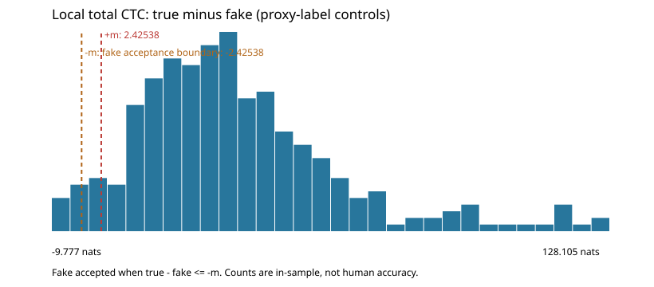

# Day 1 calibrated automatic acoustic verification

Original pre-verification transcripts are candidate A for all 85 items, including the six earlier edits. Candidate B substitutes the frozen ASR variant.
Identical local audio covers the disputed words plus one neighbouring word on either side, padded 0.2 s. Word edges come from CPU WhisperX forced alignment of ORIGINAL text. Scores are total CTC log-likelihoods in nats, summed over valid paths, never per-frame averages.
CPU wav2vec2 runs in an isolated scoring process, fixed seed, evaluation mode, one thread, highest float32 precision, disabled MKLDNN/MHA fastpaths and deterministic PyTorch settings. Impossible paths or invalid windows remain UNSURE. A preliminary mixed-process cache differed from fresh CPU scores by about 0.002 nats; it is preserved as pre_isolation evidence and superseded, not passed off as deterministic.

For insertions at the very start/end of a transcript, the missing outer neighbour is replaced by the prepared-clip boundary so disputed edge audio is not silently omitted. Edge noise/readout material may affect those preferences; complete spoken words are not human-confirmed.

Margin m = 2.42537847608 total nats. Empirical fake-acceptance rate = 2.000% (6/300).
Final counts: {'APPLY_B': 64, 'KEEP_A': 18, 'UNSURE': 3}. Legacy sentence-average counts: {'APPLY_B': 6, 'KEEP_A': 17, 'UNSURE': 62}.
[Preserved old report](day01_acoustic_verification_legacy.md); full original score audit: data/review/acoustic_verification_legacy.json.

## Calibration

Three-way normalized transcript / large-v3 / medium.en agreement is a proxy label, NOT human ground truth. Controls are sampled with replacement in fixed-seed proportions to eligible words, with at least one from every recording. Prior uncertain words (and their insertion neighbours) are excluded. The margin is the smallest positive representable value satisfying inclusive fake-minus-true >= m in at most 2% of these controls; ties are excluded together.
The reported rate is in-sample, not a held-out guarantee. Related ASR/acoustic models share errors. Artificial fakes may not represent real disagreements; repeated controls and sentences are correlated. Large multi-word edit groups still span more audio than single-word controls. A universal margin may not transfer equally across edit types, speakers or recording quality.

| True minus fake statistic | Total nats |
|---|---:|
| min | -9.776505 |
| p10 | 10.452918 |
| median | 32.010259 |
| p90 | 66.038320 |
| max | 128.105003 |

| Recording | Controls | Uncertain words |
|---|---:|---:|
| gettysburg__lv_amb__orig | 10 | 0 |
| gettysburg__lv_dj__orig | 8 | 0 |
| gettysburg__lv_dl__orig | 9 | 0 |
| gettysburg__lv_eep__orig | 10 | 1 |
| gettysburg__lv_fb__orig | 11 | 1 |
| gettysburg__lv_jn__orig | 11 | 0 |
| gettysburg__lv_law__orig | 11 | 0 |
| gettysburg__lv_lb__orig | 11 | 0 |
| gettysburg__lv_mas__orig | 11 | 0 |
| gettysburg__lv_mk__orig | 11 | 0 |
| gettysburg__lv_pc__orig | 11 | 0 |
| gettysburg__lv_rk__orig | 5 | 0 |
| gettysburg__lv_sa__orig | 15 | 0 |
| gettysburg__lv_tg__orig | 7 | 0 |
| gettysburg__lv_wt__orig | 11 | 0 |
| jfk_rice__jfk__orig | 19 | 0 |
| o_captain__lv_apc__orig | 10 | 0 |
| o_captain__lv_chip__orig | 7 | 0 |
| o_captain__lv_foxits__orig | 9 | 0 |
| o_captain__lv_jtm__orig | 11 | 0 |
| o_captain__lv_mac__orig | 10 | 0 |
| o_captain__lv_mb__orig | 10 | 0 |
| o_captain__lv_md__orig | 8 | 0 |
| o_captain__lv_mrg__orig | 7 | 0 |
| o_captain__lv_rg__orig | 8 | 1 |
| o_captain__lv_s__orig | 11 | 0 |
| o_captain__lv_sjs__orig | 5 | 0 |
| o_captain__lv_ss__orig | 9 | 0 |
| o_captain__lv_th__orig | 9 | 0 |
| reagan_challenger__reagan__orig | 15 | 0 |

Total uncertain words: 3. Indices are zero-based FINAL as-spoken whitespace-word indices. Unresolved insertions exclude both neighbouring words because no inserted word exists. Later reference statistics and evaluation must exclude these indices.

## Prepared audio and ASR regeneration

| Recording | Old cut (source s) | New cut (source s) |
|---|---|---|
| o_captain__lv_apc__orig | 12.307–45.959 | 12.307–121.611 |
| o_captain__lv_chip__orig | 0.456–42.289 | 0.456–109.772 |
| o_captain__lv_foxits__orig | 14.104–42.291 | 14.104–106.348 |
| o_captain__lv_jtm__orig | 12.553–44.770 | 12.553–109.761 |
| o_captain__lv_mac__orig | 10.132–31.564 | 10.132–80.727 |
| o_captain__lv_mb__orig | 20.203–45.762 | 20.203–102.072 |
| o_captain__lv_md__orig | 29.704–61.378 | 29.704–142.732 |
| o_captain__lv_rg__orig | 33.384–63.692 | 33.384–125.473 |
| o_captain__lv_s__orig | 10.955–38.800 | 10.955–97.716 |
| o_captain__lv_sjs__orig | 9.837–39.866 | 9.837–107.820 |
| o_captain__lv_ss__orig | 18.996–43.560 | 18.996–106.284 |
| o_captain__lv_th__orig | 7.932–32.766 | 7.932–86.466 |

All 12 full-source large-v3 caches were actually regenerated from raw audio; old caches are retained under data/review/legacy_asr. The repaired recordings' medium.en dispute clips were redecode-regenerated, and calibration sentences have newly decoded medium.en caches. Source timestamps stay in full-source coordinates; sentence/local windows are prepared-clip relative. All 30 cuts match excerpts.yaml and recordings.csv; all final windows are regenerated from final text and current ASR. Raw audio is unchanged.
Historical triage count: a same-input replay of commit 7f989f7 gives 178 before numeric normalization fixes and 177 after them; JFK changes from 6 to 5 groups. Fixes separate expanded digits from adjacent hyphen/letter tokens and handle commas in thousands. Evidence: data/review/triage_count_reconciliation.json. The frozen triage audit has 78 IGNORE + 14 LIKELY_ASR + 53 LISTEN + 32 LIKELY_REAL = 177, with 85 original review items. Full-poem/ASR regeneration and final edits change the new diff count; those counts refer to different inputs, not dropped review items.
This automatic marker is not human review. Verification decisions cover the original 85 items, not every newly exposed diff; additional differences remain documented in the refreshed diff report.

## Original 85 decisions

| Recording | Original time | Local window | A | B | A total | B total | B minus A | Decision |
|---|---:|---|---|---|---:|---:|---:|---|
| gettysburg__lv_amb__orig | 0.000s | 0.000–2.725s | Four | Boulay Four | -55.292126 | -74.908106 | -19.615981 | KEEP_A |
| gettysburg__lv_amb__orig | 5.898s | 5.372–6.513s | forth on this | forth upon this | -59.219026 | -46.232341 | 12.986685 | APPLY_B |
| gettysburg__lv_amb__orig | 35.132s | 34.707–35.990s | that that nation | that this nation | -65.903633 | -43.073364 | 22.830268 | APPLY_B |
| gettysburg__lv_amb__orig | 104.788s | 104.377–105.738s | from the earth. | from this earth. | -37.290134 | -18.154815 | 19.135319 | APPLY_B |
| gettysburg__lv_dj__orig | 3.454s | 2.872–4.075s | forth on this | forth upon this | -36.935304 | -32.450556 | 4.484748 | APPLY_B |
| gettysburg__lv_dj__orig | 29.868s | 29.423–30.686s | that that nation | that this nation | -45.573891 | -28.042460 | 17.531431 | APPLY_B |
| gettysburg__lv_dj__orig | 46.304s | 45.412–46.696s | consecrated it, far | consecrated , far | -28.210206 | -21.655195 | 6.555011 | APPLY_B |
| gettysburg__lv_dj__orig | 53.858s | 52.746–54.272s | but it can | but I can | -111.456507 | -116.116156 | -4.659649 | KEEP_A |
| gettysburg__lv_dj__orig | 96.718s | 96.333–102.880s | from the earth. | from this earth. | -640.522671 | -632.153179 | 8.369493 | APPLY_B |
| gettysburg__lv_dl__orig | 4.455s | 3.788–5.130s | forth on this | forth upon this | -46.816017 | -33.080801 | 13.735215 | APPLY_B |
| gettysburg__lv_dl__orig | 38.041s | 37.579–38.921s | that that nation | that this nation | -48.894484 | -30.250369 | 18.644115 | APPLY_B |
| gettysburg__lv_dl__orig | 51.492s | 51.149–52.632s | we can not hallow -- this | we cannot hollow -- this | -45.765054 | -35.483672 | 10.281382 | APPLY_B |
| gettysburg__lv_dl__orig | 117.529s | 117.151–125.478s | from the earth. | from this earth. | -824.401545 | -819.923186 | 4.478359 | APPLY_B |
| gettysburg__lv_eep__orig | 5.097s | 4.421–5.663s | forth on this | forth upon this | -43.055297 | -30.894438 | 12.160859 | APPLY_B |
| gettysburg__lv_eep__orig | 43.817s | 43.453–44.675s | that that nation | that this nation | -57.280779 | -39.957188 | 17.323591 | APPLY_B |
| gettysburg__lv_eep__orig | 144.421s | 143.983–154.869s | from the earth. | from this earth. | -585.799275 | -586.407627 | -0.608352 | UNSURE |
| gettysburg__lv_fb__orig | 5.278s | 4.691–6.013s | forth on this | forth upon this | -14.681634 | -11.978233 | 2.703401 | APPLY_B |
| gettysburg__lv_fb__orig | 34.952s | 34.157–35.861s | that that nation | that this nation | -55.881728 | -38.523225 | 17.358503 | APPLY_B |
| gettysburg__lv_fb__orig | 46.688s | 46.321–47.986s | we can not hallow -- this | we cannot hollow -- this | -21.108085 | -10.918286 | 10.189799 | APPLY_B |
| gettysburg__lv_fb__orig | 77.636s | 77.336–78.256s | be here dedicated | be  dedicated | -80.260698 | -42.629614 | 37.631084 | APPLY_B |
| gettysburg__lv_fb__orig | 78.838s | 78.316–79.477s | task remaining | task of remaining | -56.377303 | -48.505427 | 7.871876 | APPLY_B |
| gettysburg__lv_fb__orig | 109.661s | 109.223–114.928s | from the earth. | from this earth. | -616.539254 | -615.113938 | 1.425315 | UNSURE |
| gettysburg__lv_jn__orig | 4.735s | 3.973–5.416s | forth on this | forth upon this | -45.703858 | -32.253673 | 13.450185 | APPLY_B |
| gettysburg__lv_jn__orig | 34.628s | 34.284–35.487s | that that nation | that this nation | -49.287893 | -35.153937 | 14.133956 | APPLY_B |
| gettysburg__lv_jn__orig | 105.610s | 105.220–106.541s | from the earth. | from this earth. | -48.272091 | -27.482108 | 20.789983 | APPLY_B |
| gettysburg__lv_law__orig | 10.041s | 9.537–10.678s | forth on this | forth upon this | -63.850864 | -52.639046 | 11.211819 | APPLY_B |
| gettysburg__lv_law__orig | 38.888s | 38.523–39.746s | that that nation | that this nation | -61.398592 | -37.405620 | 23.992972 | APPLY_B |
| gettysburg__lv_law__orig | 105.533s | 105.143–106.404s | from the earth. | from this earth. | -42.346570 | -23.791647 | 18.554923 | APPLY_B |
| gettysburg__lv_lb__orig | 0.000s | 0.000–2.324s | Four | b Four | -63.996160 | -26.400843 | 37.595317 | APPLY_B |
| gettysburg__lv_lb__orig | 6.700s | 5.952–7.454s | forth on this | forth upon this | -46.854039 | -30.328471 | 16.525568 | APPLY_B |
| gettysburg__lv_lb__orig | 47.159s | 46.735–48.178s | that that nation | that this nation | -51.924731 | -32.690934 | 19.233797 | APPLY_B |
| gettysburg__lv_lb__orig | 145.656s | 145.220–155.065s | from the earth. | from this earth. | -986.640029 | -977.038559 | 9.601470 | APPLY_B |
| gettysburg__lv_mas__orig | 5.858s | 5.210–6.632s | forth on this | forth upon this | -32.356056 | -19.811719 | 12.544337 | APPLY_B |
| gettysburg__lv_mas__orig | 58.978s | 58.594–60.016s | that that nation | that this nation | -50.831032 | -27.130911 | 23.700122 | APPLY_B |
| gettysburg__lv_mas__orig | 190.057s | 189.627–190.948s | from the earth. | from this earth. | -31.132965 | -10.226868 | 20.906098 | APPLY_B |
| gettysburg__lv_mk__orig | 4.134s | 3.592–4.714s | forth on this | forth upon this | -55.493156 | -40.463072 | 15.030084 | APPLY_B |
| gettysburg__lv_mk__orig | 38.009s | 37.626–38.788s | that that nation | that this nation | -79.758517 | -62.360419 | 17.398098 | APPLY_B |
| gettysburg__lv_mk__orig | 113.476s | 113.109–120.976s | from the earth. | from this earth. | -843.265210 | -836.013108 | 7.252102 | APPLY_B |
| gettysburg__lv_pc__orig | 4.155s | 3.648–4.990s | forth on this | forth upon this | -48.798792 | -39.832360 | 8.966432 | APPLY_B |
| gettysburg__lv_pc__orig | 36.666s | 36.242–37.565s | that that nation | that this nation | -41.312426 | -23.186699 | 18.125727 | APPLY_B |
| gettysburg__lv_pc__orig | 50.402s | 49.876–51.861s | we can not hallow -- this | we cannot hollow -- this | -37.025890 | -26.840507 | 10.185382 | APPLY_B |
| gettysburg__lv_pc__orig | 113.687s | 113.168–114.348s | people, for | people, and for | -22.528867 | -6.107114 | 16.421753 | APPLY_B |
| gettysburg__lv_pc__orig | 116.852s | 116.470–124.735s | from the earth. | from this earth. | -842.027439 | -837.558153 | 4.469286 | APPLY_B |
| gettysburg__lv_rk__orig | 4.858s | 4.210–5.493s | forth on this | forth upon this | -34.107688 | -30.690798 | 3.416889 | APPLY_B |
| gettysburg__lv_rk__orig | 9.126s | 8.080–9.983s | Liberty, and dedicated | Liberty,  dedicated | -89.498904 | -76.007647 | 13.491258 | APPLY_B |
| gettysburg__lv_rk__orig | 38.342s | 37.958–39.321s | that that nation | that this nation | -51.219055 | -36.503324 | 14.715731 | APPLY_B |
| gettysburg__lv_rk__orig | 65.051s | 64.494–65.937s | little note, nor | little , nor | -28.579076 | -39.370474 | -10.791398 | KEEP_A |
| gettysburg__lv_rk__orig | 120.963s | 120.500–129.366s | from the earth. | from this earth. | -549.797148 | -542.614189 | 7.182959 | APPLY_B |
| gettysburg__lv_sa__orig | 4.215s | 3.667–4.809s | forth on this | forth upon this | -46.680445 | -36.908262 | 9.772183 | APPLY_B |
| gettysburg__lv_sa__orig | 41.527s | 41.145–42.407s | that that nation | that this nation | -53.924844 | -33.866910 | 20.057935 | APPLY_B |
| gettysburg__lv_sa__orig | 81.370s | 79.351–80.334s | here. It is | here.  is | -61.777608 | -45.153957 | 16.623651 | APPLY_B |
| gettysburg__lv_tg__orig | 3.814s | 3.292–4.435s | forth on this | forth upon this | -22.822224 | -10.741740 | 12.080484 | APPLY_B |
| gettysburg__lv_tg__orig | 10.642s | 10.197–11.500s | men are created | men were created | -98.411179 | -77.226674 | 21.184505 | APPLY_B |
| gettysburg__lv_tg__orig | 13.224s | 12.746–13.988s | we are engaged | we have engaged | -42.319397 | -24.823735 | 17.495662 | APPLY_B |
| gettysburg__lv_tg__orig | 32.828s | 32.484–33.666s | that that nation | that this nation | -71.915091 | -49.381830 | 22.533260 | APPLY_B |
| gettysburg__lv_tg__orig | 102.678s | 102.269–109.496s | from the earth. | from this earth. | -1043.078401 | -1031.540857 | 11.537544 | APPLY_B |
| gettysburg__lv_wt__orig | 4.757s | 4.142–5.384s | forth on this | forth upon this | -42.415247 | -28.396590 | 14.018657 | APPLY_B |
| gettysburg__lv_wt__orig | 40.915s | 40.510–41.913s | that that nation | that this nation | -77.833531 | -59.896815 | 17.936717 | APPLY_B |
| gettysburg__lv_wt__orig | 125.069s | 124.659–126.000s | from the earth. | from this earth. | -41.503701 | -19.541368 | 21.962333 | APPLY_B |
| jfk_rice__jfk__orig | 5.475s | 4.433–9.222s | Texas?  We | Texas?  We choose to go to the moon We | -307.795799 | -152.257098 | 155.538702 | APPLY_B |
| jfk_rice__jfk__orig | 38.896s | 38.556–39.317s | one which we | one  we | -39.149885 | -9.643003 | 29.506882 | APPLY_B |
| jfk_rice__jfk__orig | 150.222s | 143.534–152.297s | spacecraft now | spacecraft The Mariner spacecraft now | -104.867858 | -81.697705 | 23.170153 | APPLY_B |
| o_captain__lv_apc__orig | 0.000s | 0.000–0.944s | O | 2006 O | -113.529465 | -74.448817 | 39.080648 | APPLY_B |
| o_captain__lv_apc__orig | 33.102s | 32.936–109.304s | dead. O Captain! my Captain! rise up and hear the bells; Rise up- for you the flag is flung- for you the bugle trills, For you bouquets and ribbon’d wreaths- for you the shores a-crowding, For you they call, the swaying mass, their eager faces turning;        Here Captain! dear father!          This arm beneath your head!            It is some dream that on the deck,              You’ve fallen cold and dead. My Captain does not answer, his lips are pale and still, My father does not feel my arm, he has no pulse nor will, The ship is anchor’d safe and sound, its voyage closed and done, From fearful trip the victor ship comes in with object won;        Exult O shores, and ring O bells!          But I with mournful tread,            Walk the deck my Captain lies,              Fallen cold and dead. | dead. . | -126.028965 | -10305.429073 | -10179.400108 | KEEP_A |
| o_captain__lv_chip__orig | 41.242s | 41.058–109.316s | dead. O Captain! my Captain! rise up and hear the bells; Rise up- for you the flag is flung- for you the bugle trills, For you bouquets and ribbon’d wreaths- for you the shores a-crowding, For you they call, the swaying mass, their eager faces turning;        Here Captain! dear father!          This arm beneath your head!            It is some dream that on the deck,              You’ve fallen cold and dead. My Captain does not answer, his lips are pale and still, My father does not feel my arm, he has no pulse nor will, The ship is anchor’d safe and sound, its voyage closed and done, From fearful trip the victor ship comes in with object won;        Exult O shores, and ring O bells!          But I with mournful tread,            Walk the deck my Captain lies,              Fallen cold and dead. | dead. . | -138.837523 | -9282.296767 | -9143.459244 | KEEP_A |
| o_captain__lv_foxits__orig | 27.597s | 27.431–92.244s | dead. O Captain! my Captain! rise up and hear the bells; Rise up- for you the flag is flung- for you the bugle trills, For you bouquets and ribbon’d wreaths- for you the shores a-crowding, For you they call, the swaying mass, their eager faces turning;        Here Captain! dear father!          This arm beneath your head!            It is some dream that on the deck,              You’ve fallen cold and dead. My Captain does not answer, his lips are pale and still, My father does not feel my arm, he has no pulse nor will, The ship is anchor’d safe and sound, its voyage closed and done, From fearful trip the victor ship comes in with object won;        Exult O shores, and ring O bells!          But I with mournful tread,            Walk the deck my Captain lies,              Fallen cold and dead. | dead. . | -727.898320 | -10585.738963 | -9857.840643 | KEEP_A |
| o_captain__lv_jtm__orig | 31.686s | 31.513–97.208s | dead. O Captain! my Captain! rise up and hear the bells; Rise up- for you the flag is flung- for you the bugle trills, For you bouquets and ribbon’d wreaths- for you the shores a-crowding, For you they call, the swaying mass, their eager faces turning;        Here Captain! dear father!          This arm beneath your head!            It is some dream that on the deck,              You’ve fallen cold and dead. My Captain does not answer, his lips are pale and still, My father does not feel my arm, he has no pulse nor will, The ship is anchor’d safe and sound, its voyage closed and done, From fearful trip the victor ship comes in with object won;        Exult O shores, and ring O bells!          But I with mournful tread,            Walk the deck my Captain lies,              Fallen cold and dead. | dead. . | -130.948965 | -10130.734268 | -9999.785303 | KEEP_A |
| o_captain__lv_mac__orig | 20.821s | 20.608–70.595s | dead. O Captain! my Captain! rise up and hear the bells; Rise up- for you the flag is flung- for you the bugle trills, For you bouquets and ribbon’d wreaths- for you the shores a-crowding, For you they call, the swaying mass, their eager faces turning;        Here Captain! dear father!          This arm beneath your head!            It is some dream that on the deck,              You’ve fallen cold and dead. My Captain does not answer, his lips are pale and still, My father does not feel my arm, he has no pulse nor will, The ship is anchor’d safe and sound, its voyage closed and done, From fearful trip the victor ship comes in with object won;        Exult O shores, and ring O bells!          But I with mournful tread,            Walk the deck my Captain lies,              Fallen cold and dead. | dead. . | -123.031065 | -9528.707085 | -9405.676020 | KEEP_A |
| o_captain__lv_mb__orig | 25.048s | 24.842–81.869s | dead. O Captain! my Captain! rise up and hear the bells; Rise up- for you the flag is flung- for you the bugle trills, For you bouquets and ribbon’d wreaths- for you the shores a-crowding, For you they call, the swaying mass, their eager faces turning;        Here Captain! dear father!          This arm beneath your head!            It is some dream that on the deck,              You’ve fallen cold and dead. My Captain does not answer, his lips are pale and still, My father does not feel my arm, he has no pulse nor will, The ship is anchor’d safe and sound, its voyage closed and done, From fearful trip the victor ship comes in with object won;        Exult O shores, and ring O bells!          But I with mournful tread,            Walk the deck my Captain lies,              Fallen cold and dead. | dead. . | -100.406970 | -9953.272548 | -9852.865578 | KEEP_A |
| o_captain__lv_md__orig | 31.144s | 30.955–113.028s | dead. O Captain! my Captain! rise up and hear the bells; Rise up- for you the flag is flung- for you the bugle trills, For you bouquets and ribbon’d wreaths- for you the shores a-crowding, For you they call, the swaying mass, their eager faces turning;        Here Captain! dear father!          This arm beneath your head!            It is some dream that on the deck,              You’ve fallen cold and dead. My Captain does not answer, his lips are pale and still, My father does not feel my arm, he has no pulse nor will, The ship is anchor’d safe and sound, its voyage closed and done, From fearful trip the victor ship comes in with object won;        Exult O shores, and ring O bells!          But I with mournful tread,            Walk the deck my Captain lies,              Fallen cold and dead. | dead. . | -1063.900489 | -9079.877122 | -8015.976634 | KEEP_A |
| o_captain__lv_mrg__orig | 11.225s | 10.598–12.506s | people all exulting, | people are exulting, | -107.876120 | -79.437758 | 28.438362 | APPLY_B |
| o_captain__lv_mrg__orig | 25.716s | 24.795–26.644s | Fallen cold and | Fallen pulled and | -29.654461 | -42.610864 | -12.956403 | KEEP_A |
| o_captain__lv_mrg__orig | 86.202s | 85.626–86.412s | dead. | dead. End | -42.326560 | -19.650910 | 22.675650 | APPLY_B |
| o_captain__lv_rg__orig | 15.604s | 14.849–16.198s | follow eyes the | follow I as the | -31.586843 | -30.532374 | 1.054469 | UNSURE |
| o_captain__lv_rg__orig | 29.598s | 29.407–92.089s | dead. O Captain! my Captain! rise up and hear the bells; Rise up- for you the flag is flung- for you the bugle trills, For you bouquets and ribbon’d wreaths- for you the shores a-crowding, For you they call, the swaying mass, their eager faces turning;        Here Captain! dear father!          This arm beneath your head!            It is some dream that on the deck,              You’ve fallen cold and dead. My Captain does not answer, his lips are pale and still, My father does not feel my arm, he has no pulse nor will, The ship is anchor’d safe and sound, its voyage closed and done, From fearful trip the victor ship comes in with object won;        Exult O shores, and ring O bells!          But I with mournful tread,            Walk the deck my Captain lies,              Fallen cold and dead. | dead. . | -107.070283 | -10296.813151 | -10189.742867 | KEEP_A |
| o_captain__lv_s__orig | 27.655s | 27.190–86.761s | dead. O Captain! my Captain! rise up and hear the bells; Rise up- for you the flag is flung- for you the bugle trills, For you bouquets and ribbon’d wreaths- for you the shores a-crowding, For you they call, the swaying mass, their eager faces turning;        Here Captain! dear father!          This arm beneath your head!            It is some dream that on the deck,              You’ve fallen cold and dead. My Captain does not answer, his lips are pale and still, My father does not feel my arm, he has no pulse nor will, The ship is anchor’d safe and sound, its voyage closed and done, From fearful trip the victor ship comes in with object won;        Exult O shores, and ring O bells!          But I with mournful tread,            Walk the deck my Captain lies,              Fallen cold and dead. | dead. Oh. | -146.143240 | -11159.364766 | -11013.221526 | KEEP_A |
| o_captain__lv_sjs__orig | 21.589s | 20.369–24.280s | heart! heart!          O the | heart! Hot! Oh the | -36.877401 | -50.022975 | -13.145574 | KEEP_A |
| o_captain__lv_sjs__orig | 29.539s | 29.362–97.983s | dead. O Captain! my Captain! rise up and hear the bells; Rise up- for you the flag is flung- for you the bugle trills, For you bouquets and ribbon’d wreaths- for you the shores a-crowding, For you they call, the swaying mass, their eager faces turning;        Here Captain! dear father!          This arm beneath your head!            It is some dream that on the deck,              You’ve fallen cold and dead. My Captain does not answer, his lips are pale and still, My father does not feel my arm, he has no pulse nor will, The ship is anchor’d safe and sound, its voyage closed and done, From fearful trip the victor ship comes in with object won;        Exult O shores, and ring O bells!          But I with mournful tread,            Walk the deck my Captain lies,              Fallen cold and dead. | dead. . | -268.000922 | -8247.145445 | -7979.144523 | KEEP_A |
| o_captain__lv_ss__orig | 24.054s | 23.883–87.288s | dead. O Captain! my Captain! rise up and hear the bells; Rise up- for you the flag is flung- for you the bugle trills, For you bouquets and ribbon’d wreaths- for you the shores a-crowding, For you they call, the swaying mass, their eager faces turning;        Here Captain! dear father!          This arm beneath your head!            It is some dream that on the deck,              You’ve fallen cold and dead. My Captain does not answer, his lips are pale and still, My father does not feel my arm, he has no pulse nor will, The ship is anchor’d safe and sound, its voyage closed and done, From fearful trip the victor ship comes in with object won;        Exult O shores, and ring O bells!          But I with mournful tread,            Walk the deck my Captain lies,              Fallen cold and dead. | dead. . | -1348.744607 | -10631.995403 | -9283.250796 | KEEP_A |
| o_captain__lv_th__orig | 24.604s | 24.057–78.534s | dead. O Captain! my Captain! rise up and hear the bells; Rise up- for you the flag is flung- for you the bugle trills, For you bouquets and ribbon’d wreaths- for you the shores a-crowding, For you they call, the swaying mass, their eager faces turning;        Here Captain! dear father!          This arm beneath your head!            It is some dream that on the deck,              You’ve fallen cold and dead. My Captain does not answer, his lips are pale and still, My father does not feel my arm, he has no pulse nor will, The ship is anchor’d safe and sound, its voyage closed and done, From fearful trip the victor ship comes in with object won;        Exult O shores, and ring O bells!          But I with mournful tread,            Walk the deck my Captain lies,              Fallen cold and dead. | dead. Oh. | -94.586573 | -9289.552277 | -9194.965704 | KEEP_A |
| reagan_challenger__reagan__orig | 20.163s | 19.794–20.456s | all of the | all  the | -26.532604 | -6.290057 | 20.242547 | APPLY_B |
| reagan_challenger__reagan__orig | 52.695s | 51.294–54.584s | Smith, Dick Scobee, Judith | Smith, Nick Scobie, Judith | -37.100309 | -40.530487 | -3.430178 | KEEP_A |
| reagan_challenger__reagan__orig | 66.138s | 64.349–66.382s | together.  For the | together.   the | -49.272524 | -23.245960 | 26.026564 | APPLY_B |
| reagan_challenger__reagan__orig | 214.902s | 214.588–216.031s | and an historian | and the historian | -24.898451 | -20.247731 | 4.650720 | APPLY_B |
| reagan_challenger__reagan__orig | 232.610s | 232.301–233.043s | us by the | us for the | -39.654732 | -30.933458 | 8.721274 | APPLY_B |
