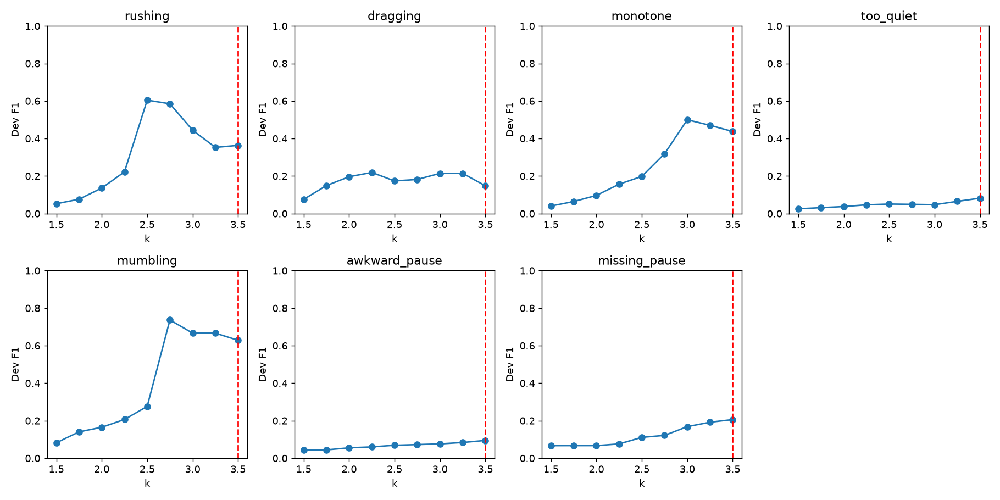

# Phase 6 development calibration

Files: 152; split: DEV only; setting: A-LOSO.

Deterministic coordinate sweeps account for cross-type suppression. Each type is swept over 1.5–3.5 in increments of 0.25, up to three rounds. Ties prefer the conservative threshold. This is coordinate optimization, not exhaustive joint optimization.

| Type | Selected k | Dev F1 |
|---|---:|---:|
| rushing | 3.50 | 0.36363636363636365 |
| dragging | 3.50 | 0.14814814814814814 |
| monotone | 3.50 | 0.4375 |
| too_quiet | 3.50 | 0.08205128205128205 |
| mumbling | 3.50 | 0.6285714285714286 |
| awkward_pause | 3.50 | 0.0947867298578199 |
| missing_pause | 3.50 | 0.20588235294117646 |

Combined clean-dev alarms/min: 1.777; ≤0.5 guard satisfied: False.
Severity cut points: [2.0, 2.75, 3.5, 4.059, 6591.0]; matched DEV Spearman: 0.1572985835046175.

Synthetic labels describe controlled effects, not human perceptual judgments. Human recordings/labels are pending. No held-out test values selected these thresholds. Learned detector deferred under the plan cut line.
