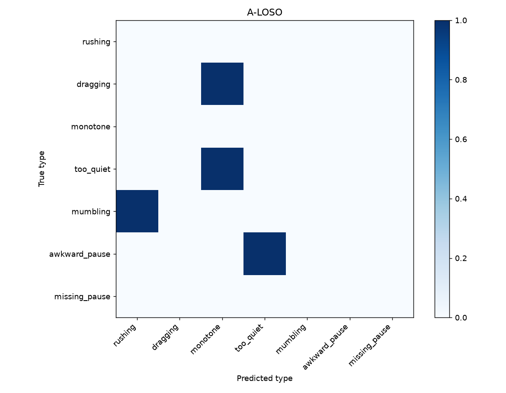
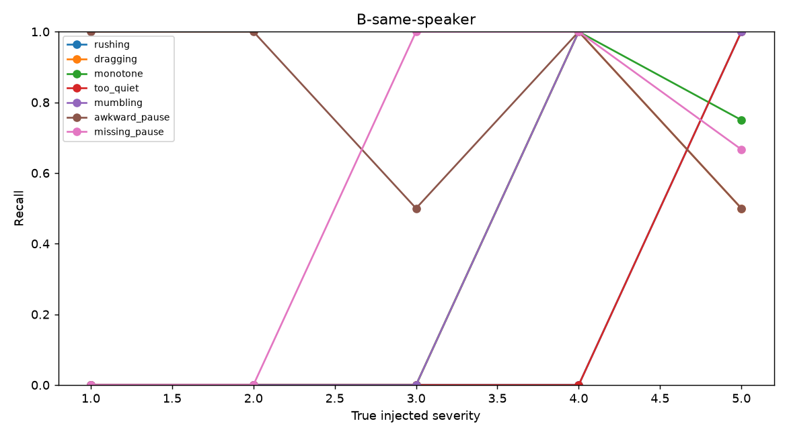
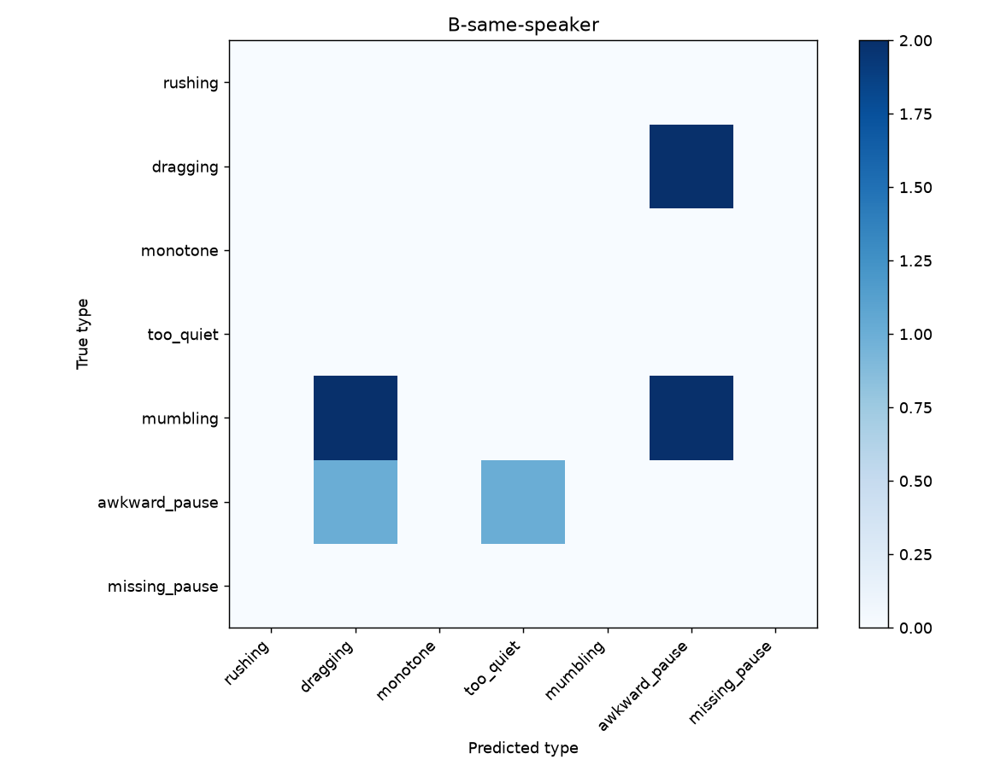

# Phase 6 detection results

Evaluated code commit: `aaf1832fe24a193d4c90f9e7a2ff9537b753335c`.

Detector settings were selected on DEV only. These are synthetic-effect labels, not human judgments of speaking quality.
The DEV clean-alarm guard was **not met**: 1.777 alarms/min versus the requested ≤0.5. This is an acceptance limitation, not a passing result. See [DEV calibration](phase06_calibration.md).
Learned detector: not trained; PLAN cut line 2.

## A-LOSO

Files: 190; uncertain truth regions excluded: 0.

| Type | Precision | Recall (95% CI) | F1 (95% CI) | Onset ms | Offset ms | Clean alarms/min |
|---|---:|---|---|---:|---:|---:|
| rushing | 0.625 | 0.167 [0.038, 0.312] | 0.263 [0.067, 0.450] | 80.000 | 12.000 | 0.000 |
| dragging | 1.000 | 0.185 [0.055, 0.343] | 0.312 [0.105, 0.511] | 479.000 | 7.000 | 0.000 |
| monotone | 0.100 | 0.419 [0.240, 0.606] | 0.161 [0.087, 0.242] | 105.000 | 619.000 | 0.335 |
| too_quiet | 0.714 | 0.179 [0.040, 0.333] | 0.286 [0.069, 0.487] | 215.000 | 205.000 | 0.000 |
| mumbling | 1.000 | 0.483 [0.304, 0.667] | 0.651 [0.467, 0.800] | 119.000 | 74.000 | 0.000 |
| awkward_pause | 0.156 | 0.903 [0.778, 1.000] | 0.265 [0.197, 0.332] | 15.500 | 39.000 | 0.447 |
| missing_pause | 0.038 | 0.414 [0.240, 0.600] | 0.070 [0.037, 0.108] | 6.000 | 6.500 | 0.559 |
| overall | 0.125 | 0.400 [0.328, 0.471] | 0.190 [0.156, 0.223] | 26.000 | 40.500 | 1.341 |

Highest measured recall: awkward_pause (0.903); lowest: rushing (0.167). This is conditional on this dataset, aligner and injected effects—not a human realism claim.

## B-same-speaker

Files: 76; uncertain truth regions excluded: 0.

| Type | Precision | Recall (95% CI) | F1 (95% CI) | Onset ms | Offset ms | Clean alarms/min |
|---|---:|---|---|---:|---:|---:|
| rushing | 0.500 | 0.182 [0.000, 0.462] | 0.267 [0.000, 0.556] | 57.500 | 5.000 | 0.000 |
| dragging | 0.059 | 0.273 [0.000, 0.600] | 0.097 [0.000, 0.197] | 84.000 | 510.000 | 0.000 |
| monotone | 1.000 | 0.357 [0.100, 0.625] | 0.526 [0.182, 0.769] | 325.000 | 660.000 | 0.000 |
| too_quiet | 0.667 | 0.200 [0.000, 0.500] | 0.308 [0.000, 0.615] | 10.500 | 307.500 | 0.000 |
| mumbling | 0.800 | 0.364 [0.083, 0.667] | 0.500 [0.125, 0.800] | 136.000 | 229.000 | 0.000 |
| awkward_pause | 0.007 | 0.833 [0.600, 1.000] | 0.014 [0.007, 0.024] | 37.500 | 32.500 | 0.000 |
| missing_pause | 0.019 | 0.462 [0.182, 0.750] | 0.037 [0.012, 0.065] | 10.000 | 3.500 | 0.000 |
| overall | 0.018 | 0.390 [0.289, 0.494] | 0.035 [0.026, 0.045] | 31.000 | 35.500 | 0.000 |

Highest measured recall: awkward_pause (0.833); lowest: rushing (0.182). This is conditional on this dataset, aligner and injected effects—not a human realism claim.

## Human-A

Eight genuine recordings and actual recorder consent/prose notes are supplied.
Local ASR drafts are explicitly unconfirmed; confirmed as-spoken transcripts and
complete supported-type/time or sentence annotations are not available. The
validator stops at the missing fenced JSON annotation block. Human-A v1 primary
and separately labelled post-hoc v2 have not run; hits/misses/false positives are
not estimable, not zero. See `phase10_human_takes.md` and `phase10_asr_review.md`.
No recordings, labels, listening, scores or rater data were invented; no tuning.

## Human-B

Own take01 baselines exist for both texts, but the same annotation/transcript
gate blocks B02–04 comparisons. No genuine dashboard jobs or accuracy counts
are claimed. V1 remains primary and frozen; v2 is secondary/post-hoc. Future
workflow execution must include take04 rather than silently omitting it.
No labels or rehearsal improvement were inferred from "random flaws" or the
recorder's subjective assessment. Independent rater responses remain zero;
human agreement is a disclosed limitation, not replaced by AI or self-ratings.

## Limitations

File-level bootstrap CIs use 1,000 resamples with a fixed seed. Reference models use train speakers only. Uncertain truth regions and overlapping predictions are excluded symmetrically. Visual gold boundaries have a pending human spot-check. Missing human settings prevent full Phase 6 acceptance.
