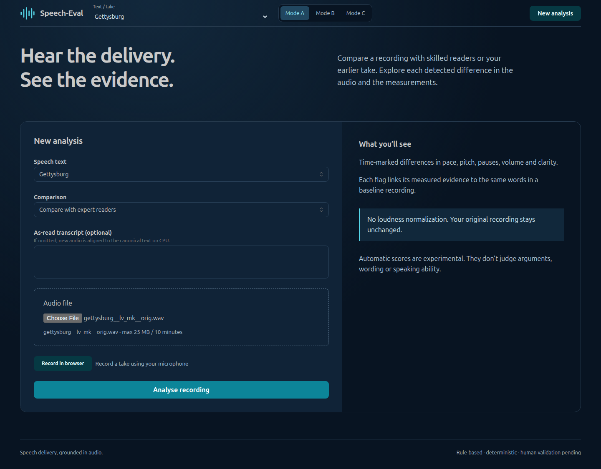
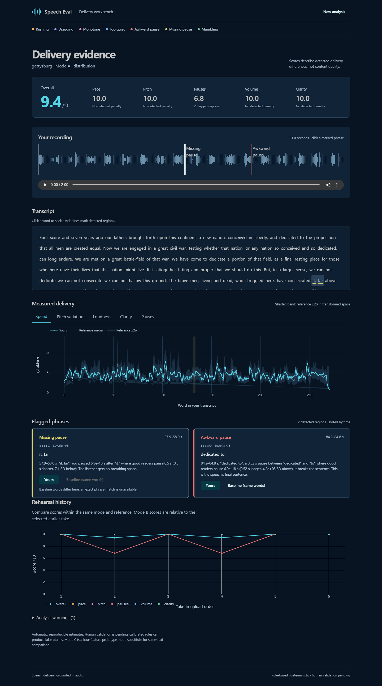
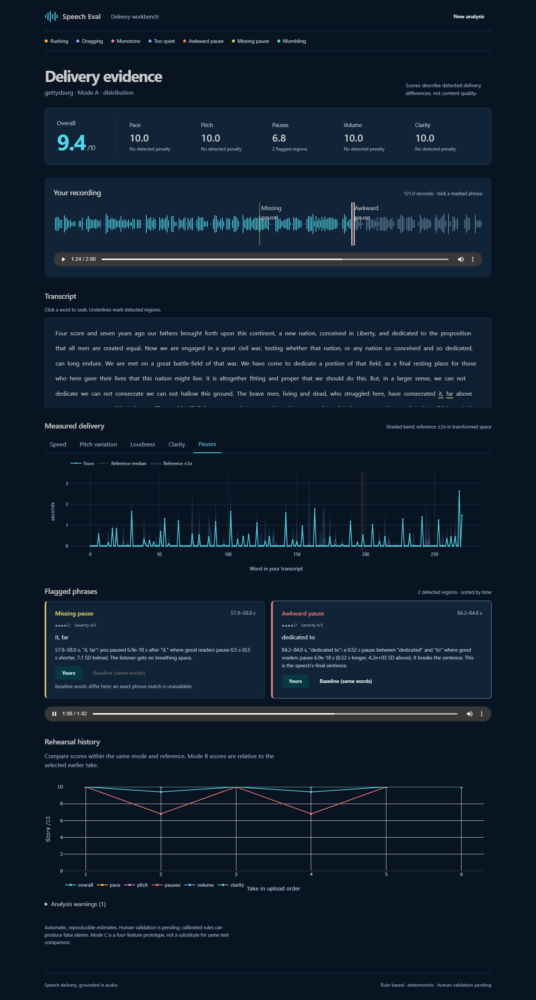
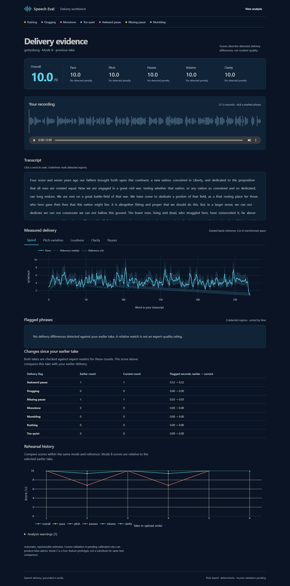
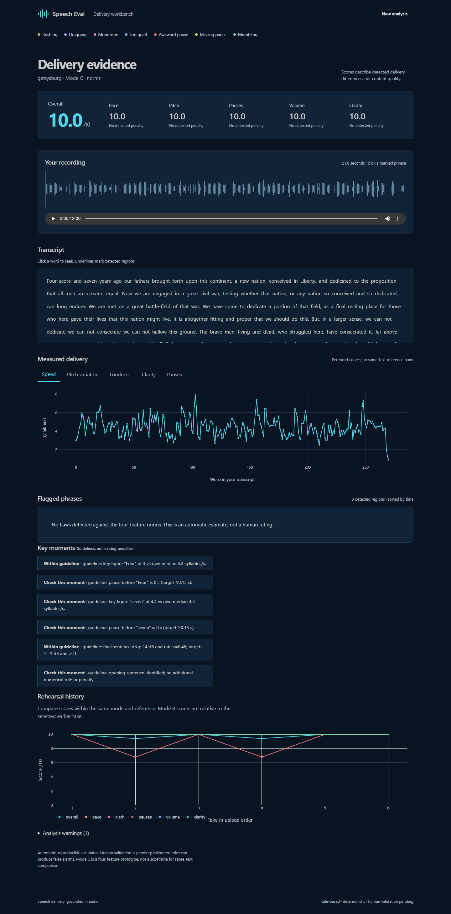

# Phase 9 — browser verification

Verified on 2026-10-10 against the actual FastAPI service and prepared LibriVox
recording `gettysburg__lv_mk__orig`, not mocked scoring responses. Chromium
145.0.7632.6; desktop 1440×1000 and phone-width 390×844. Machine evidence is
[`ui_verification.json`](ui_verification.json), including the audio SHA-256.

## Results

All three Playwright tests pass: upload/mode controls, browser recording lifecycle,
and the real API journey through Modes A, B and C. The production TypeScript/Vite
build passes. The Python suite passed 192 tests after the dashboard changes.

| Mode | Overall | Regions | Checked |
|---|---:|---:|---|
| A | 9.4 | 2 | Waveform, selectable regions, numeric explanations, scores, feature plot and phrase playback |
| B | 10.0 | 0 | Same recording vs earlier take, per-flaw change table and rehearsal history |
| C | 10.0 | 0 | Norms, key-moment guidelines, no invented same-text baseline or reference band |

Playback assertions require the actual audio clock to advance. The exact phrase
“dedicated to” plays in both recordings. “it, far” is unavailable in the expert
baseline: its button is disabled with an explicit explanation, rather than
silently playing different words. Waveform-region selection updates the matching
card and feature highlight. Narrow-screen checks wait for responsive chart
resizing and then reject horizontal overflow. No uncaught page errors or stale
playback alerts remain.

The initially failing smoke used a missing fixture and inappropriate audio/region
selectors. The replacement uses the real prepared audio, the dedicated phrase
player and Wavesurfer's multi-token shadow `part` attribute. Visual inspection
also exposed an interrupted-play promise reported after switching clips; stale
requests now cannot overwrite the newer playback state. Screenshots wait for
waveform decode in all modes.

## Run again

Restore the prepared corpus first (audio is intentionally not in Git). From the
repository root, start the API:

```sh
uv run uvicorn api.main:app --host 0.0.0.0 --port 8000
```

In another terminal:

```sh
cd web
npm ci
npx playwright install chromium
npm run dev
```

Then, from `web/`, run `npm test` and `npm run build`. `UI_BASE_URL` can target
another frontend, including the Compose proxy. `PLAYWRIGHT_CHROMIUM_EXECUTABLE`
can select an already-installed Chromium. This verification used the existing
Windows Chromium installation and Windows Node against the WSL checkout; UNC
development requires `VITE_POLLING=1`. No microphone belonging to the user was
activated: the recording test uses Chromium's isolated fake audio device.

## Screenshots







## Limits

This prepared recording reuses existing alignment/features; its elapsed UI time
is not a cold-alignment latency benchmark. Real microphone quality, the user's
new recordings and independent human ratings remain separate checks.
The production-proxy rerun and cross-environment CPU identity are now recorded
in [Docker verification](docker_verification.json) and [Docker instructions](../docs/DOCKER.md).
The production rerun passed all three browser tests and all 200 Python tests,
including own-speech transcript gating and canonical Mode C upload coverage.
The frontend build warns about its Plotly-heavy
bundle size; that warning does not prevent the build or browser functionality.
