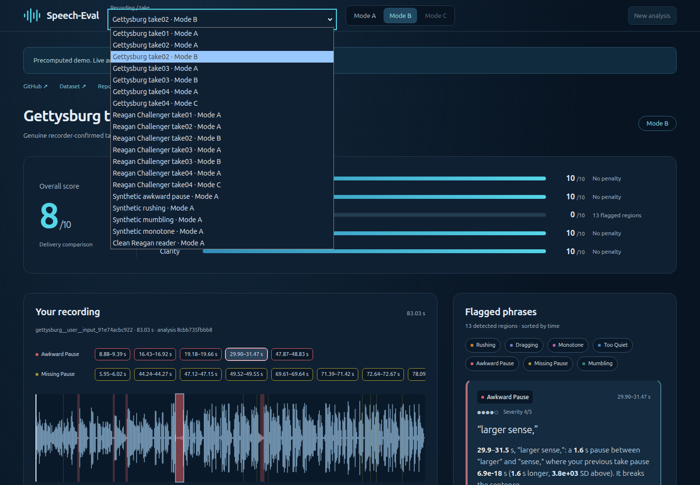

# Recording picker contrast fix — 2026-10-13

The native option menu inherited pale text while its backing surface was left to the browser/Windows theme. Both the public static demo and the local dashboard now explicitly pair `#e5eff7` text with a solid `#102033` background for options and the header picker. Native selection and keyboard behaviour are retained.

The new contrast regression tests failed before the fix and pass afterward. Isolated browser suite: **6 passed** (41.0 s), including all 19 recordings, same-word playback, external links, mobile layout and both picker-theme tests. Public picker tests: **2 passed** (5.6 s). Public computed option contrast: **14.12:1** under both light and dark browser preferences. Python: **314 passed** (15.91 s); local dashboard production build passed. All 38 static JSON files match the manifest and stored original sources.

Published at Space commit `ed2251885a877a1fbde275f783cb87f4c998199d`. Machine evidence is in `picker_contrast_verification.json`. Validation used an isolated checkout based on `f43a2b9` because a separate dashboard refactor was changing the shared sources and test output directory. This fix does not include that refactor or its new presentation test; the six baseline/contrast tests passed in isolation.

