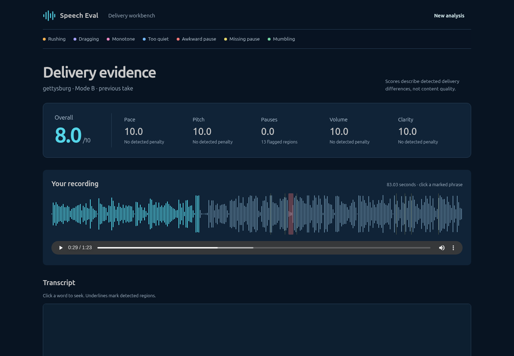

# Dashboard UI redesign — 2026-10-13

`ui-v1` was tagged and pushed before editing: GitHub `b4b6e22`; the Space also has a rollback tag at `4d7a2f2`. Work started at 05:21:27 UTC, with a three-hour deadline of 08:21:27 UTC. The redesign passed verification before the deadline; no rollback was needed.

The local dashboard and precomputed demo now use a spacious dark navy layout with a 64 px desktop header, recording/take picker, segmented modes, a large overall score and five horizontal category bars. The main recording/phrase columns use approximately 65/35 proportions. Waveforms are 180 px tall with a seconds axis, playhead, exact-width flag bands, and separate scrollable label lanes. The sticky, time-sorted phrase list has flaw filters, severity dots, larger quoted words, bold/tabular numbers, and Yours / Baseline (same words) controls. Modes stay within the selected recording; unavailable comparisons are disabled. Mode C tips have their own **Heuristic tips (not scored)** card. Below 1024 px the recording and phrase list stack.

Existing fonts and flaw colours were retained, with visible focus rings and keyboard-operable regions and filters. No dependency was added. All original analysis JSON, audio, scores, explanation wording/numbers, API and scientific source files remain unchanged. The report source and PDF were not edited or rebuilt.

Before and after show the same genuine Gettysburg take02 Mode B “larger | sense” hit at 29.90–31.47 s:

[Phrase detail](img/ui_region.png), [1280 px laptop](img/ui_laptop.png), [mobile](img/ui_mobile.png), [public Space](img/hf_space.png). Every original `ui_*.png` screenshot was regenerated; the explicitly named `*_before.png` files preserve the old comparison views.

Verification:

- Python: **314 passed** (20.37 s).
- Live Playwright: **6 passed** (20.8 s), retaining upload, browser recording, Modes A/B/C, exact phrase playback, feature plots, genuine-hit selection and exact waveform widths. Only selectors changed: the renamed tips heading and the declared media source element used by WaveSurfer's blob-backed player.
- Static Node checks: **2 passed**. Static Playwright: **3 passed locally** (40.0 s) and **3 passed publicly** (1.7 min), exercising all 19 examples and both audio sources; no page errors, failed responses or API calls.
- All **38 JSON files** match their manifest and stored sources locally and on the public host. Published CSS/JS assets match the build byte-for-byte; hosted HTML differs only by Hugging Face's platform variable injection.
- Every rendered static explanation matches its original text across all 19 views. Eleven live/static viewport checks cover 390–1440 px: no page overflow, 180 px waveforms, correct responsive stacking. Filters and keyboard selection passed. SHA256 checks preserved **6,463** backend/data/source files and the **23** final-packaging protected files. Genuine-hit evidence changed only screenshot hashes.
- Independent review found two presentation regressions (escaped apostrophes and cross-recording mode selection); both were fixed and browser-verified. No important findings remain.

The [public precomputed demo](https://huggingface.co/spaces/SriramMPS/Speech-Evalutaion) loaded anonymously with HTTP 200 at Space commit `05ee58e439c3a3ebe033faf465b55bbad458218d`. Evidence is in `ui_redesign_checks.json`, the existing browser verification JSON files, and `hf_public_check.json`.

Final packaging resumed after the redesign. Items 1–14 were already complete; the report-input bundle and index were refreshed with the new screenshots and this report. Existing fresh-clone/dataset reproduction evidence remains scoped to its recorded commit; unchanged scientific results were not recomputed. `NEXT.md` contains only the remaining owner actions.
